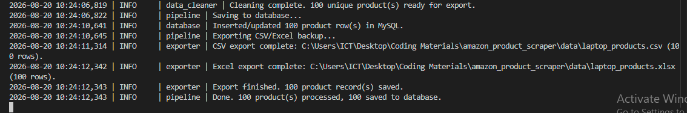
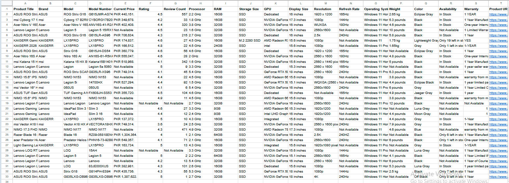

<div align="center">

# 🛒 Amazon Product Scraper

**A desktop app that scrapes *any* product category from Amazon, extracts detailed specs, cleans the data, and stores it in MySQL — with CSV/Excel backups and a simple GUI.**

[](https://www.python.org/)
[](https://www.selenium.dev/)
[](https://www.mysql.com/)
[](https://docs.python.org/3/library/tkinter.html)
[](LICENSE)

</div>

---

## 📖 Table of Contents

- [Features](#-features)
- [Tech Stack](#-tech-stack)
- [Screenshots](#-screenshots)
- [Folder Structure](#-folder-structure)
- [Installation](#-installation)
- [MySQL Setup](#-mysql-setup)
- [How to Run](#-how-to-run)
- [Example Usage](#-example-usage)
- [Data Fields](#-data-fields)
- [Future Improvements](#-future-improvements)
- [License](#-license)

---

## ✨ Features

| | |
|---|---|
| 🖥️ **Desktop GUI** | Enter any search keyword and page count, click Start, watch a live progress bar and status messages. Nothing is hardcoded — search "laptop" today, "wireless mouse" tomorrow. |
| 🔍 **Two-stage scraping** | Search-results listings first, then a full visit to each product's detail page for specs (RAM, storage, processor, GPU, and more). |
| 🧠 **Robust spec extraction** | Scans multiple page sections (spec tables, "Additional Information", detail bullets, "About this item") with fallback strategies — far fewer `Not Available` fields than a single-selector scraper. |
| 🛡️ **RAM vs. Storage safeguard** | Amazon sellers label these inconsistently across categories; the parser double-checks each value's actual text (`DDR4/DDR5/LPDDR...` vs. `SSD/HDD/NVMe/eMMC`) before assigning it to a column. |
| 💰 **Single, accurate price field** | `Current Price` always holds the actual amount the customer pays right now, discount or not. |
| 🗄️ **MySQL storage** | Database and table created automatically on first run; an older table is auto-migrated to the current schema. Every row is tagged with the `keyword` it was scraped under, and re-scraping a product **updates** its row instead of duplicating it (`ON DUPLICATE KEY UPDATE` on `product_url`). |
| 📊 **Dynamic CSV / Excel export** | Every run writes a backup file named after what you searched for — e.g. `wireless_mouse_products.csv`, `monitor_products.xlsx`. |
| 🧯 **Resilient by design** | A failure on one product (timeout, CAPTCHA, missing element) is logged and skipped — it never crashes the run. The initial search itself retries automatically on a transient block. |
| 📝 **Logging** | Every run logs to both the console and `logs/scraper.log`, including an end-of-run field-completeness report. |

---

## 🧰 Tech Stack

<div align="center">

| Layer | Technology |
|---|---|
| Language |  |
| Browser Automation |  |
| HTML Parsing |  |
| Database |  via `mysql-connector-python` |
| GUI |  (Python standard library) |
| Data Export |  |
| Configuration |  |

</div>

---

## 📸 Screenshots

**Live console output** — logging, migration, and export all visible in real time:



**Sample output** — cleaned, structured data ready in Excel/CSV, with no field left to guesswork:



---

## 📁 Folder Structure

```
amazon_scraper/
├── main.py              # Entry point — launches the GUI
├── gui.py                # Tkinter desktop interface
├── pipeline.py            # Orchestrates scrape -> parse -> clean -> store
├── scraper.py              # Search-results (listing) page scraping
├── product_parser.py        # Product detail page parsing (specs)
├── data_cleaner.py           # Pure normalization/cleaning functions
├── database.py                # MySQL connection, schema, upserts
├── exporter.py                 # CSV/Excel export
├── config.py                    # Central settings (incl. .env loading)
├── logger_config.py              # Centralized logging setup
├── requirements.txt
├── .env.example                  # Template for your local .env
├── .gitignore
├── Images/                        # Screenshots used in this README
├── data/                          # CSV/Excel output (git-ignored)
└── logs/                          # Log files (git-ignored)
```

---

## ⚙️ Installation

**1. Clone the repository**
```bash
git clone https://github.com/abdullahamin-ai/Amazon-Product-Scrapper.git
cd Amazon-Product-Scrapper
```

**2. Create a virtual environment** (recommended)
```bash
python3 -m venv venv
source venv/bin/activate   # Windows: venv\Scripts\activate
```

**3. Install dependencies**
```bash
pip install -r requirements.txt
```

> **Linux users:** Tkinter ships with Python on Windows/macOS, but on some Linux distros it's a separate system package:
> ```bash
> sudo apt-get install python3-tk
> ```

**4. Chrome browser** must be installed — `webdriver-manager` downloads the matching ChromeDriver automatically, no manual setup needed.

---

## 🗄️ MySQL Setup

1. Install and start MySQL Server locally (or point at a remote instance).
2. Copy the environment template and fill in your credentials:
   ```bash
   cp .env.example .env
   ```
   ```env
   MYSQL_HOST=localhost
   MYSQL_PORT=3306
   MYSQL_USER=root
   MYSQL_PASSWORD=your_mysql_password_here
   MYSQL_DATABASE=amazon_scraper
   ```
3. That's it — the app creates the `amazon_scraper` database and the `products` table automatically on first launch. An existing table from an older version of this project is automatically migrated to the current schema on startup too. No manual SQL needed either way.

---

## ▶️ How to Run

```bash
python main.py
```

This opens the desktop window:

1. Type **any** search keyword — laptop, wireless mouse, mechanical keyboard, monitor, SSD, mobile, headphones, printer, whatever you want to scrape
2. Enter the number of search-result pages to scrape, e.g. `5`
3. Click **Start Scraping**
4. Watch the progress bar and status line update live
5. On completion, you'll see a summary with the count of products saved and the paths to the CSV/Excel backup files (named after your keyword, e.g. `data/monitor_products.csv`)

Invalid input (empty keyword, zero/negative/non-numeric page count) is rejected with a clear error message before any scraping starts.

---

## 💡 Example Usage

```
Search Product: wireless mouse
Pages: 3

Status: Found 54 product(s). Fetching details...
Status: Processed 54/54 products...
Status: Saving to database...
Status: Done. 51 product(s) processed, 51 saved to database.
```

**Output files:** `data/wireless_mouse_products.csv`, `data/wireless_mouse_products.xlsx`

Query the results directly in MySQL — every row is tagged with the `keyword` it was scraped under, so multiple categories coexist cleanly in the same table:

```sql
SELECT product_title, brand, ram, storage_size, price
FROM amazon_scraper.products
WHERE keyword = 'wireless mouse'
ORDER BY scraped_at DESC;
```

---

## 🗂️ Data Fields

| Field | Notes |
|---|---|
| Product Title, Brand, Model, Model Number | |
| Current Price | Actual selling price, discount or not |
| Rating, Review Count | |
| Processor, RAM, Storage Size, GPU | Storage Size always includes capacity + type when available, e.g. `512GB SSD` |
| Display Size, Resolution, Refresh Rate | |
| Operating System, Weight, Color | |
| Availability, Warranty | |
| Product URL, Image URL, Scraped Date | |

Fields that can't be reliably found are stored as `Not Available` — the scraper never guesses or inserts inaccurate data just to fill a column.

---

## 🚀 Future Improvements

- [ ] Scheduled/automated daily runs for price-history tracking
- [ ] A results table view inside the GUI (not just a completion summary)
- [ ] Export filters (e.g. only products under a given price)
- [ ] Multi-keyword batch scraping in one run
- [ ] Dockerized MySQL + app for one-command setup

---

## 📄 License

This project is licensed under the MIT License.

```
MIT License

Copyright (c) 2026 Abdullah Amin

Permission is hereby granted, free of charge, to any person obtaining a copy
of this software and associated documentation files (the "Software"), to deal
in the Software without restriction, including without limitation the rights
to use, copy, modify, merge, publish, distribute, sublicense, and/or sell
copies of the Software, and to permit persons to whom the Software is
furnished to do so, subject to the following conditions:

The above copyright notice and this permission notice shall be included in all
copies or substantial portions of the Software.

THE SOFTWARE IS PROVIDED "AS IS", WITHOUT WARRANTY OF ANY KIND, EXPRESS OR
IMPLIED, INCLUDING BUT NOT LIMITED TO THE WARRANTIES OF MERCHANTABILITY,
FITNESS FOR A PARTICULAR PURPOSE AND NONINFRINGEMENT. IN NO EVENT SHALL THE
AUTHORS OR COPYRIGHT HOLDERS BE LIABLE FOR ANY CLAIM, DAMAGES OR OTHER
LIABILITY, WHETHER IN AN ACTION OF CONTRACT, TORT OR OTHERWISE, ARISING FROM,
OUT OF OR IN CONNECTION WITH THE SOFTWARE OR THE USE OR OTHER DEALINGS IN THE
SOFTWARE.
```

See [LICENSE](LICENSE) for the full text.

---

<div align="center">

Made with ☕ and a lot of `WebDriverWait` by **[Abdullah Amin](https://github.com/abdullahamin-ai)**

</div>
